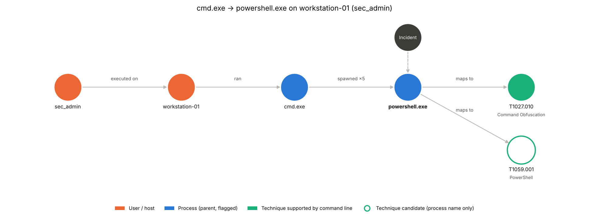

# Incident Enrichment Layer

**Author:** Shambhavi Shekhar · **Version:** 0.4.0 · **Status:** proof of concept, tested on lab and sample data

The Incident Enrichment Layer sits **after the correlation engine** in the SOC pipeline. It takes a finding and turns it into a structured, explainable incident. Two kinds of finding are supported, each with its own path:

| Finding | Source | Path |
|---|---|---|
| SSH / authentication | Sigma correlation (or simulated threshold) + Wazuh alerts/archives | sessions, attempts, login outcome |
| Sigma correlations from ClickHouse | `wazuh_correlations` + `wazuh_ocsf_events` | same as SSH, plus merging and an integrity check per finding |
| Process execution anomaly | Isolation Forest (`wazuh_ml_anomalies`) + OCSF process events (`wazuh_ocsf_events`) | process lineage, volume and score, command context |

SSH path:

```
Wazuh alerts + archives ─┐
                         ├─► normalise ─► de-duplicate ─► retrieve context ─► score relationships
Correlated finding ──────┘                                                          │
                                                                                    ▼
          incident object (JSON)  ◄─ graph ◄─ MITRE techniques ◄─ sessions + outcome ◄─ timeline
```

For each finding it produces:

- **Canonical events.** Wazuh writes the same log line to both `alerts.json` and `archives.json`; these are merged, with provenance kept (`sources`, `record_uids`).
- **Timeline** ordered by the time written in the log line, not Wazuh's ingestion time.
- **Relationship scoring.** Each event is scored against the finding and labelled `direct` (shares the source IP) or `inferred` (user + host + time only).
- **SSH sessions and outcome:** attempts per session, how each session ended, and whether any login succeeded.
- **MITRE ATT&CK techniques** with an evidence status (`observed` / `attempted_only`) and sub-technique → parent links.
- **Incident graph** (incident → sessions → events → techniques, plus entities).
- **Figures:** incident graph, activity heatmap, impact-scope card.


Process path, for each anomaly:

- **Linked events:** `direct` (listed in the anomaly's `contributing_finding_uids`), `inferred` (same host, user and parent → process inside the window, not listed), `context` (other process activity on the host). Listed events missing from the input are reported, not hidden.
- **Process groups** by (host, user, parent → process).
- **Outcome:** host and user, lineage, occurrence count, Isolation Forest scores (lower is more anomalous), sample command line.
- **MITRE ATT&CK candidates** from the process and its command line, each with its basis: `candidate` (process name only), `supported_by_command_line`, or `reported_by_source` (OCSF `attacks`).
- **Graph:** user –executed_on→ host –ran→ parent process –spawned→ process –maps_to→ technique.
- **Figures:** process graph, activity timeline, scope card.



## Quick start

```bash
pip install -e .            # or: pip install -e ".[dev]" to include pytest

python -m incident_enrichment \
    --alerts   data/sample/alerts.json \
    --archives data/sample/archives.json \
    --out      output/
```

Output on the sample data:

```
INC-DC1CEACF  (finding-sim-001, simulated_sigma_threshold)
  events: 17  raw records: 31  sessions: 2  failed attempts: 6  successful logins: 0
  6 failed SSH password attempts for user root from 192.168.1.34 on host agent, in 2 session(s)
  between 04:03:41 and 04:06:32 UTC. No successful login from this source was observed in the
  available logs. The SSH service on the host started 3 s before the first attempt.
```

`output/` then contains `INC-….json` (the incident object) and three PNG figures.

### Process anomalies

From ClickHouse exports (`FORMAT JSON` or `JSONEachRow`, UTF-8 or UTF-16):

```bash
python -m incident_enrichment \
    --anomalies      data/sample/process/ml_anomalies.json \
    --process-events data/sample/process/ocsf_process_events.json \
    --out            output/
```

Straight from ClickHouse, use the bridge in `integrations/` (needs `pip install -e ".[clickhouse]"` and the `CLICKHOUSE_*` environment variables; see the script's header).

### Sigma correlations from ClickHouse

The bridge reads `wazuh_correlations` for the last `--hours`, and for each attack fetches the OCSF events behind it. It does not take the correlation row at face value:

| Safeguard | What it does |
|---|---|
| Robust parsing | Arrays as lists or JSON strings, duplicate or empty uids, naive or swapped timestamps, source IP / host recovered from `group_key`. A row without `finding_uid` is skipped and counted, never fatal. |
| Duplicate rows | The same correlation inserted twice is read once. |
| Merging | Findings with the same source IP, a compatible host and windows at most `merge_gap` (10 min) apart become **one incident** (e.g. brute force + password spraying from one IP). |
| Evidence recovery | Events are fetched by the engine's uids **and** by source IP / host up to `recovery_after` (10 min) past the finding, so attempts the finding does not list are still included. Events from a different source IP never join the incident. |
| Engine-linked events | Every event the engine listed is in the incident and marked `engine_linked`; listed events that cannot be found are reported in `evidence.engine_uids_missing`. |
| Integrity check | Each finding's rule (threshold, group-by, time span, base event codes) is re-evaluated on **distinct** events, with and without recovered events. |
| Input hardening | When `raw_data` is missing or broken, the record is rebuilt from the OCSF columns. Fields of the wrong type are treated as missing. |
| Isolation | One failing group is recorded in `run_report.json` and the run continues. |

Integrity verdicts (`integrity.verdict`, one per finding in `integrity.findings`):

| Verdict | Meaning | `recommended_action` |
|---|---|---|
| `confirmed` | The rule's condition holds on distinct events. | triage |
| `confirmed_with_recovered_evidence` | Holds only once recovered events are added. | triage |
| `below_threshold_after_dedup` | After removing duplicate records the condition does not hold: duplicates were counted. | review |
| `below_threshold` | Does not hold on the available events, and no duplicates explain it. | review |
| `unverifiable` | Listed events are missing, or a field cannot be mapped. | review |
| `rule_unknown` | The rule is not in the catalogue. | triage (not re-checked) |

**Snapshots.** On the reliability branch the engine stores each finding as cumulative snapshots (same `finding_uid`, rising `snapshot_version`). The bridge reads `wazuh_correlations FINAL`, and also keeps only the highest `snapshot_version` per (`tenant_uid`, `finding_uid`) itself, so exported files and older tables give the same result. The incident id does not change as later snapshots or findings join, so a rerun updates the same `INC-*.json`.

**Tenants.** Every query is filtered by the finding's `tenant_uid`; findings from different tenants are never merged; events from another tenant are dropped even if passed in; each incident carries `tenant_uid`, and its id includes it (the same `finding_uid` in two tenants gives two incidents).

Rule definitions come from the engine's Sigma YAML files with `--rules-dir`; without it, built-in copies of the two SSH rules are used. Offline, from exports:

```bash
python integrations/integrate_clickhouse_enrichment.py --from-files \
    --correlations tests/fixtures/sigma/correlations.json \
    --sigma-events tests/fixtures/sigma/ocsf_events.json --out output_sigma/
```

```
[+] INC-4A29D4EC  Multiple SSH Authentication Failures  events 3  verdict below_threshold_after_dedup
[+] INC-F5F244EF  Multiple SSH Authentication Failures + SSH Password Spraying  events 5  verdict confirmed
[done] 2 Sigma incident(s) from 3 finding(s) (1 duplicate / 1 malformed rows), 0 process incident(s), 1 error(s).
```

The first case lists 5 records that are only 3 distinct login attempts (two delivered twice), below the rule's threshold of 5. The second merges a spraying finding that lists 3 users with a brute-force finding that lists all 5, into one incident with all 5 attempts.

### Running in the pipeline

The bridge is a batch job over a lookback window, meant to run on a schedule (e.g. every few minutes with an overlapping window). Settings are environment variables (see `.env.example`); each can also be passed as an option.

| Variable | Default | Meaning |
|---|---|---|
| `CLICKHOUSE_HOST`, `CLICKHOUSE_PORT`, `CLICKHOUSE_USER`, `CLICKHOUSE_DATABASE` | `127.0.0.1`, `8123`, `lm_admin`, `default` | connection |
| `CLICKHOUSE_PASSWORD` | (required) | never hard-coded |
| `ENRICH_OUT_DIR` | `output_clickhouse` | where `INC-*.json`, figures and `run_report.json` go |
| `ENRICH_LOOKBACK_HOURS` | `24` | correlations and anomalies from the last N hours |
| `ENRICH_RULES_DIR` | built-in SSH rules | the engine's `sigma-engine/rules` folder |
| `ENRICH_TENANT_UID` | all tenants (each isolated) | process one tenant only |
| `ENRICH_CORRELATIONS_FINAL` | `1` | set `0` for tables created before the snapshot schema |

```bash
set -a; source .env; set +a
python integrations/integrate_clickhouse_enrichment.py
```

Inputs: `wazuh_correlations` and `wazuh_ml_anomalies`, plus the original events behind them from `wazuh_ocsf_events`. Outputs: one `INC-*.json` per incident (with figures) and `run_report.json`. Example outputs are in `docs/sample_output/`.

**ML anomalies** are read with the ML worker's schema: `anomaly_uid`, `tenant_uid`, `occurrence_count`, `first_seen_time`, `last_seen_time`, `min_score`, `mean_score` (Isolation Forest decision function; lower is more anomalous) and `contributing_finding_uids`. Host, user and parent → process are taken from the listed OCSF process events (event codes 4688, 1, 91802, 67027) when the anomaly row does not carry them.

**Output contract** (read by the Wiki and analytics scripts; checked by `tests/test_integration.py`): `incident_id`, `incident_type` (`ssh_authentication` / `process_execution`), `tenant_uid`, `finding.title`, `finding.source_ip`, `finding.target_host`, `finding.target_user`, `entities.source_ips` / `users` / `hosts`, `techniques[]` with `technique`, `name`, `status`, `timeline[]`, `sessions[]`; for ML incidents also `outcome.lineage`, `outcome.occurrence_count`, `outcome.min_anomaly_score`.

### Using a real finding

Without `--finding`, findings are **simulated** with a Sigma-style threshold rule (≥ 5 auth-failure alerts from one source IP within 10 minutes). To enrich a finding from the Sigma engine instead, pass it as JSON:

```bash
python -m incident_enrichment --alerts … --archives … --finding data/sample/finding_example.json
```

Required fields: `finding_id`, `title`, `source_ip`, `target_user`, `target_host`, `first_seen`, `last_seen` (ISO 8601). Optional: `techniques`, `finding_source`.

### From Python

```python
from incident_enrichment import enrich_files

result = enrich_files("data/sample/alerts.json", "data/sample/archives.json")[0]
result.incident          # DataFrame of incident events (E1…E17)
result.sessions          # list of SSH sessions with outcome
result.techniques        # MITRE techniques with evidence status
result.graph             # networkx.DiGraph
result.incident_object   # dict, same as the JSON written by the CLI
```

```python
from incident_enrichment import enrich_process_finding
from incident_enrichment.process import finding_from_anomaly, normalize_ocsf_process_events

finding = finding_from_anomaly(anomaly_row)            # one wazuh_ml_anomalies row
events = normalize_ocsf_process_events(ocsf_rows)      # wazuh_ocsf_events rows
result = enrich_process_finding(finding, events)
result.outcome, result.groups, result.techniques, result.graph, result.incident_object
```

## Repository layout

```
src/incident_enrichment/
  loader.py         read Wazuh JSON-lines files
  normalize.py      flat record per raw line; event_time from syslog; fallback field parsing
  canonicalize.py   merge alert/archive duplicates by host + log line; stable event_uid
  finding.py        simulated Sigma threshold findings; load an external finding
  scoring.py        context window, relationship scores, direct / inferred / service_context
  sessions.py       SSH session reconstruction, outcome, MITRE technique assessment
  sigma.py          Sigma safeguards: rule catalogue, robust findings, merging, integrity check, OCSF row -> record
  process.py        process path: ClickHouse loaders, linking, groups, outcome, MITRE candidates, graph
  graph.py          incident graph (networkx)
  viz.py            figures for both paths
  pipeline.py       end-to-end enrichment and incident object
  __main__.py       command line
integrations/       ClickHouse bridge (Sigma correlations + ML anomalies -> incidents)
tests/              regression and edge-case tests; tests/fixtures/ holds synthetic process and Sigma fixtures
data/sample/        lab Wazuh logs (alerts.json, archives.json) + example finding
data/sample/process/ ClickHouse exports of wazuh_ml_anomalies and wazuh_ocsf_events
notebooks/          exploratory notebook with the same pipeline, step by step
docs/figures/       figures generated from the sample data
```

## Incident object (schema 0.4)

`incident_type` is `ssh_authentication` or `process_execution`. Shared fields are below; process incidents carry `process_groups` (and an empty `sessions`), `context_events`, and `evidence.missing_event_uids`, and their `outcome` holds the process summary.

| Field | Content |
|---|---|
| `incident_id`, `tenant_uid`, `status`, `closed_at`, `watch_until` | identity (stable across reruns), tenant, lifecycle (lifecycle fields reserved; `status` is `open`) |
| `finding` | the input finding, including `finding_source` (`simulated_sigma_threshold`, `sigma`, …) |
| `outcome` | sessions, failed attempts, successful logins, overall status |
| `sessions` | per-session start/end, source port, attempts, how it ended |
| `entities` | source IPs, users, hosts |
| `techniques` | MITRE id, name, tactic, parent, `status`, evidence events |
| `timeline` | one entry per canonical event: `event_uid`, times, session, rule, link type, score, provenance |
| `service_context` | SSH-service events on the host near the incident (e.g. sshd started) |
| `graph` | nodes and edges |
| `evidence`, `evidence_summary` | counts, unique event ids, a one-paragraph summary |
| `integrity` | (Sigma) verdict, per-finding re-check, `recommended_action`; with `finding.merged_from` and `evidence.engine_linked_events` / `recovered_events` / `engine_uids_missing` |

## Sample data

`data/sample/process/` holds ClickHouse exports supplied by the team: two Isolation Forest anomalies (`cmd.exe → powershell.exe` and `powershell.exe → certutil.exe` on `workstation-01`) and 15 baseline OCSF events. The anomalies' linked events are not in that export, so `tests/fixtures/process_linked_events.json` adds hand-made events with matching uids (marked synthetic) to test linking.

`data/sample/` contains Wazuh logs from a lab test VM (`agent`, 192.168.1.42), provided by Hari. Someone at 192.168.1.34 made two SSH connections as `root` with three wrong passwords each, about two and a half minutes apart. No login succeeded. The archive also contains unrelated background noise (inventory scans, disk reports, rootcheck false positives).

## Tests

```bash
pytest
```

The tests pin the expected results on the sample data (17 events, 2 sessions × 3 attempts, 0 successful logins, unique event ids, T1021.004 = `attempted_only`; for processes: linking, grouping, outcome fields, graph shape, technique basis), so any change that alters them is caught.

`tests/test_sigma.py` covers the Sigma safeguards on synthetic fixtures (`tests/fixtures/sigma/make_fixtures.py` rebuilds them): malformed and duplicate rows, JSON-string arrays, missing or swapped times, merging rules, each integrity verdict, recovered evidence, exclusion of other source IPs, broken `raw_data`, empty input, rule files with a malformed YAML, randomly corrupted rows, and an end-to-end offline bridge run.

`tests/test_integration.py` covers the hand-off checks on synthetic fixtures shaped after the reliability-branch schema and the ML worker's output (`tests/fixtures/integration/make_fixtures.py`): latest snapshot selection (rows out of order, cumulative evidence), the six-username spraying / brute-force scenario as one incident, a stable incident id across snapshots, tenant isolation (the same attack and `finding_uid` in two tenants), ML anomaly → OCSF linking with tenant-scoped context, and the incident fields the Wiki reads.

## Known limitations

- **Simulated finding by default.** Relationship scores compare events to the finding's own attributes; they are a real test only when the input is a genuine Sigma finding.
- **Hand-picked scoring weights** (+3 IP, +2 user, +2 host, +2 technique, +1 window; threshold 5).
- **Two finding types.** SSH session and outcome rules are specific to OpenSSH/PAM logs; the process path expects process-creation events.
- **Process techniques are candidates.** They come from the process name and command line, not from observed behaviour; each carries its basis.
- **Tested on one lab SSH scenario, two sample process anomalies** (whose linked events were not in the export) **and synthetic Sigma fixtures** shaped after real correlations.
- **Integrity check covers `event_count` and `value_count` rules** whose fields map to the records (source IP, host, user). Other rule types get `unverifiable`. Recovered events count towards a rule only when its base event codes are known (they are for the SSH rules; the Windows rules match on fields the records do not carry).
- **Window query is capped** at 5,000 events per attack; when hit, the incident says so (`evidence.window_truncated`).
- **Writing incidents back to ClickHouse** is not done yet; the bridge writes JSON and figures to disk.
- **Reliability-branch schema** was taken from the review notes (not yet from the branch itself): `snapshot_version`, `tenant_uid` on all three tables. To re-check against the branch once it is final.

## Changelog

See [CHANGELOG.md](CHANGELOG.md).

## Credit

Designed and built by **Shambhavi Shekhar** as part of the LogManthan SOC project. Please keep this attribution when reusing or extending the code.
