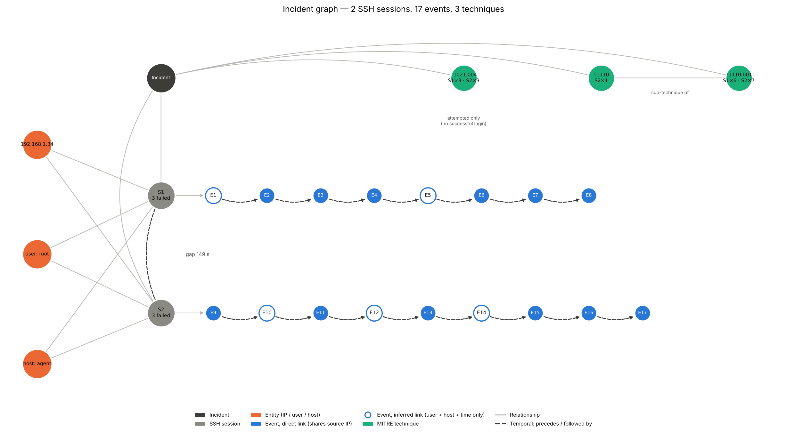

# Incident Enrichment Layer

**Author:** Shambhavi Shekhar · **Version:** 0.1.0 · **Status:** proof of concept, tested on lab data

The Incident Enrichment Layer sits **after the correlation engine** in the SOC pipeline. It takes a correlated finding (for example an SSH brute-force finding from the Sigma engine) and turns it into a structured, explainable incident:

```
Wazuh alerts + archives ─┐
                         ├─► normalise ─► de-duplicate ─► retrieve context ─► score relationships
Correlated finding ──────┘                                                          │
                                                                                    ▼
          incident object (JSON)  ◄─ graph ◄─ MITRE techniques ◄─ sessions + outcome ◄─ timeline
```

For each finding it produces:

- **Canonical events.** Wazuh writes the same log line to both `alerts.json` and `archives.json`; these are merged, with provenance kept (`sources`, `record_uids`).
- **Timeline** ordered by the time written in the log line, not Wazuh's ingestion time.
- **Relationship scoring.** Each event is scored against the finding and labelled `direct` (shares the source IP) or `inferred` (user + host + time only).
- **SSH sessions and outcome:** attempts per session, how each session ended, and whether any login succeeded.
- **MITRE ATT&CK techniques** with an evidence status (`observed` / `attempted_only`) and sub-technique → parent links.
- **Incident graph** (incident → sessions → events → techniques, plus entities).
- **Figures:** incident graph, activity heatmap, impact-scope card.



## Quick start

```bash
pip install -e .            # or: pip install -e ".[dev]" to include pytest

python -m incident_enrichment \
    --alerts   data/sample/alerts.json \
    --archives data/sample/archives.json \
    --out      output/
```

Output on the sample data:

```
INC-DC1CEACF  (finding-sim-001, simulated_sigma_threshold)
  events: 17  raw records: 31  sessions: 2  failed attempts: 6  successful logins: 0
  6 failed SSH password attempts for user root from 192.168.1.34 on host agent, in 2 session(s)
  between 04:03:41 and 04:06:32 UTC. No successful login from this source was observed in the
  available logs. The SSH service on the host started 3 s before the first attempt.
```

`output/` then contains `INC-….json` (the incident object) and three PNG figures.

### Using a real finding

Without `--finding`, findings are **simulated** with a Sigma-style threshold rule (≥ 5 auth-failure alerts from one source IP within 10 minutes). To enrich a finding from the Sigma engine instead, pass it as JSON:

```bash
python -m incident_enrichment --alerts … --archives … --finding data/sample/finding_example.json
```

Required fields: `finding_id`, `title`, `source_ip`, `target_user`, `target_host`, `first_seen`, `last_seen` (ISO 8601). Optional: `techniques`, `finding_source`.

### From Python

```python
from incident_enrichment import enrich_files

result = enrich_files("data/sample/alerts.json", "data/sample/archives.json")[0]
result.incident          # DataFrame of incident events (E1…E17)
result.sessions          # list of SSH sessions with outcome
result.techniques        # MITRE techniques with evidence status
result.graph             # networkx.DiGraph
result.incident_object   # dict, same as the JSON written by the CLI
```

## Repository layout

```
src/incident_enrichment/
  loader.py         read Wazuh JSON-lines files
  normalize.py      flat record per raw line; event_time from syslog; fallback field parsing
  canonicalize.py   merge alert/archive duplicates by host + log line; stable event_uid
  finding.py        simulated Sigma threshold findings; load an external finding
  scoring.py        context window, relationship scores, direct / inferred / service_context
  sessions.py       SSH session reconstruction, outcome, MITRE technique assessment
  graph.py          incident graph (networkx)
  viz.py            graph, heatmap and impact-scope figures
  pipeline.py       end-to-end enrichment and incident object
  __main__.py       command line
tests/              regression tests on the sample data
data/sample/        lab Wazuh logs (alerts.json, archives.json) + example finding
notebooks/          exploratory notebook with the same pipeline, step by step
docs/figures/       figures generated from the sample data
```

## Incident object (schema 0.1)

| Field | Content |
|---|---|
| `incident_id`, `status`, `closed_at`, `watch_until` | identity and lifecycle (lifecycle fields reserved; `status` is `open`) |
| `finding` | the input finding, including `finding_source` (`simulated_sigma_threshold`, `sigma`, …) |
| `outcome` | sessions, failed attempts, successful logins, overall status |
| `sessions` | per-session start/end, source port, attempts, how it ended |
| `entities` | source IPs, users, hosts |
| `techniques` | MITRE id, name, tactic, parent, `status`, evidence events |
| `timeline` | one entry per canonical event: `event_uid`, times, session, rule, link type, score, provenance |
| `service_context` | SSH-service events on the host near the incident (e.g. sshd started) |
| `graph` | nodes and edges |
| `evidence`, `evidence_summary` | counts, unique event ids, a one-paragraph summary |

## Sample data

`data/sample/` contains Wazuh logs from a lab test VM (`agent`, 192.168.1.42), provided by Hari. Someone at 192.168.1.34 made two SSH connections as `root` with three wrong passwords each, about two and a half minutes apart. No login succeeded. The archive also contains unrelated background noise (inventory scans, disk reports, rootcheck false positives).

## Tests

```bash
pytest
```

The tests pin the expected results on the sample data (17 events, 2 sessions × 3 attempts, 0 successful logins, unique event ids, T1021.004 = `attempted_only`, and so on), so any change that alters them is caught.

## Known limitations

- **Simulated finding by default.** Relationship scores compare events to the finding's own attributes; they are a real test only when the input is a genuine Sigma finding.
- **Hand-picked scoring weights** (+3 IP, +2 user, +2 host, +2 technique, +1 window; threshold 5).
- **SSH authentication only.** Session reconstruction and outcome rules are specific to OpenSSH/PAM logs.
- **Tested on one lab scenario.**
- **File input only.** Reading findings and events from ClickHouse, and writing incidents back, is the next integration step.

## Changelog

See [CHANGELOG.md](CHANGELOG.md).

## Credit

Designed and built by **Shambhavi Shekhar** as part of the LogManthan SOC project. Please keep this attribution when reusing or extending the code.
